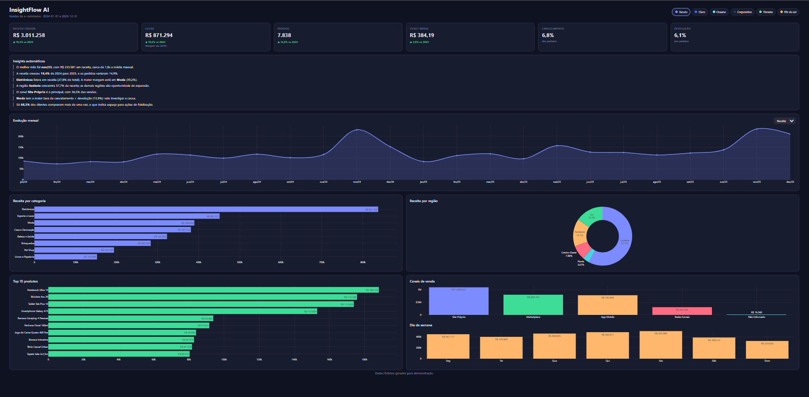
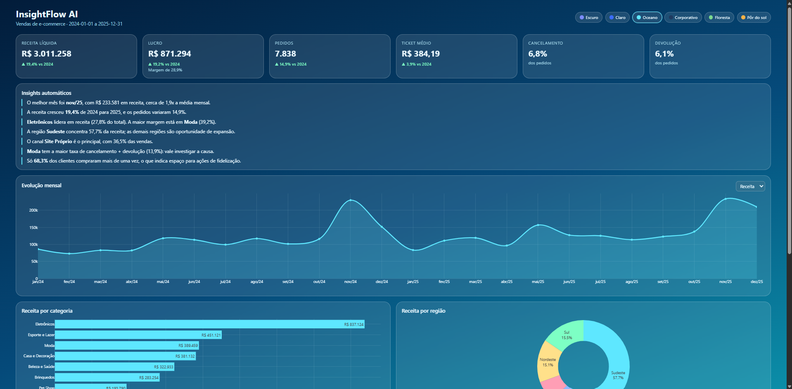
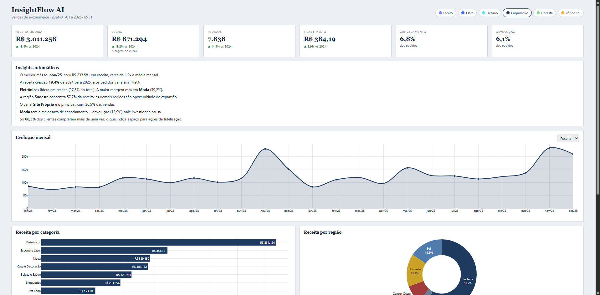
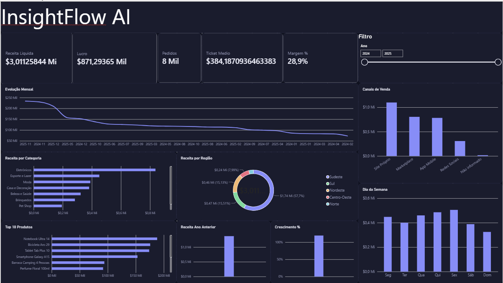
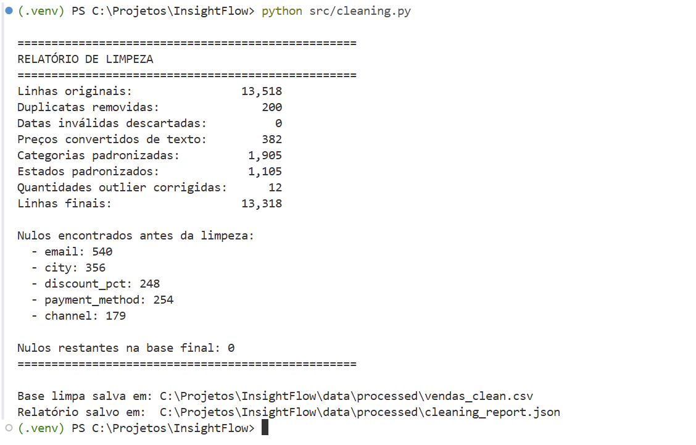

# Insight Flow AI

Pipeline de dados e dashboard web interativo para análise de vendas de e-commerce. O projeto recebe uma base bruta (com os problemas típicos de dados reais), limpa e organiza, calcula os indicadores de negócio e apresenta tudo em um dashboard personalizável com insights automáticos.

**Dashboard online:** https://matheuszottis.github.io/insight-flow-ai/

> A base de dados é **fictícia**, gerada por script para simular uma loja de e-commerce brasileira (cerca de 13 mil linhas de vendas, de 2024 a 2025).



## O que o projeto faz

1. **Gera uma base realista e "suja"**: datas em vários formatos, categorias escritas de formas diferentes, valores monetários em texto, campos vazios, quantidades absurdas e linhas duplicadas.
2. **Limpa e padroniza** os dados, recuperando informações faltantes quando possível, e gera um relatório do que foi corrigido.
3. **Calcula os indicadores**: receita, lucro, margem, ticket médio, taxas de cancelamento e devolução, crescimento anual, rankings e cortes por categoria, região, canal e dia da semana.
4. **Apresenta em um dashboard web** com gráficos interativos, insights automáticos e 6 temas visuais.

## Temas

O visual é totalmente personalizável via variáveis CSS. O dashboard vem com 6 temas: Escuro, Claro, Oceano, Corporativo, Floresta e Pôr do sol.

| Oceano | Corporativo |
|---|---|
|  |  |

## Versão em Power BI

Além do dashboard web, o mesmo modelo foi construído no Power BI, a partir da base limpa gerada pelo pipeline em Python. Inclui tabela de calendário, medidas em DAX (receita, lucro, margem, ticket médio, taxas de cancelamento e devolução, crescimento vs ano anterior) e um tema com a mesma identidade visual do dashboard web.



O arquivo está em [`powerbi/InsightFlow.pbix`](powerbi/InsightFlow.pbix).

## Relatório de limpeza



## Tecnologias

- **Python** e **pandas**: geração, limpeza e análise dos dados
- **HTML, CSS e JavaScript**: interface do dashboard
- **Plotly**: gráficos interativos
- **GitHub Pages**: publicação
- **Power BI** e **DAX**: versão complementar do dashboard

## Estrutura do projeto

```
insight-flow-ai/
├── config/             # configurações de colunas (exemplo: loja_demo.json)
├── data/
│   ├── raw/            # base de demonstração (suja)
│   └── processed/      # saídas da versão anterior do pipeline
├── src/
│   ├── generate_data.py   # gera a base fictícia
│   ├── cleaning.py        # limpeza guiada pela configuração
│   ├── kpis.py            # cálculo dos indicadores
│   └── run.py             # roda o pipeline completo para um cliente
├── web/                # modelo do dashboard (HTML, CSS, JS)
├── powerbi/            # versão em Power BI (.pbix e tema)
├── docs/               # imagens do README
└── requirements.txt
```

## Como rodar

Requer Python 3.10 ou superior.

```powershell
# 1. Criar e ativar o ambiente virtual
python -m venv .venv
.venv\Scripts\Activate.ps1

# 2. Instalar as dependências
pip install -r requirements.txt

# 3. (Opcional) Gerar a base fictícia de demonstração
python src/generate_data.py

# 4. Rodar o pipeline com a base de demonstração
python src/run.py --arquivo data/raw/vendas_raw.csv --config config/loja_demo.json
```

O resultado fica em `saida/loja-demo/`: a pasta `dashboard/` contém a página pronta (abrir `index.html`) e `dados/` contém a base limpa, o relatório de limpeza e os indicadores.

## Usando com a planilha de um cliente

Cada cliente tem um arquivo de configuração (`.json`) que diz quais colunas da planilha dele correspondem a cada informação. Basta copiar `config/loja_demo.json`, trocar o nome do cliente e, na seção `colunas`, colocar o nome exato de cada coluna da planilha.

- **Obrigatórias:** data do pedido, número do pedido, quantidade e preço unitário.
- **Opcionais:** cliente, produto, categoria, status, desconto, custo, estado, canal, forma de pagamento, entre outras. Se a planilha não tiver alguma, basta remover a linha: os indicadores que dependem dela são pulados, e o dashboard esconde os gráficos correspondentes.
- Os textos de status que contam como venda, cancelamento e devolução também são configuráveis.

```powershell
python src/run.py --arquivo clientes/nome-do-cliente/vendas.xlsx --config clientes/nome-do-cliente/config.json
```

## Regras de negócio

- Receita, lucro e ticket médio consideram apenas pedidos com status **Entregue**.
- Pedidos **Cancelados** e **Devolvidos** entram somente nas taxas de perda.
- Receita líquida = valor bruto menos desconto. O frete não entra na receita.
- Quantidades acima de 20 unidades por item são tratadas como erro de digitação.

## Roadmap

- [x] Pipeline de limpeza e indicadores
- [x] Dashboard web com temas
- [x] Versão em Power BI
- [x] Pipeline configurável por cliente (mapeamento de colunas)
- [ ] Insights escritos por IA (Claude API)

## Autor

**Matheus Zottis**: [GitHub](https://github.com/MatheusZottis)
